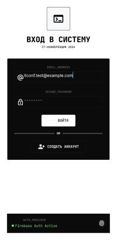
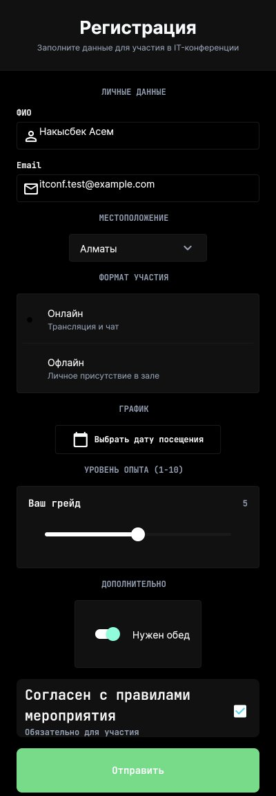
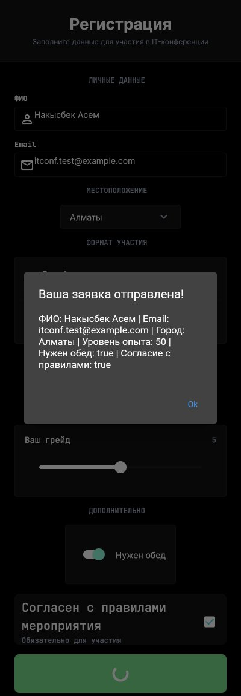
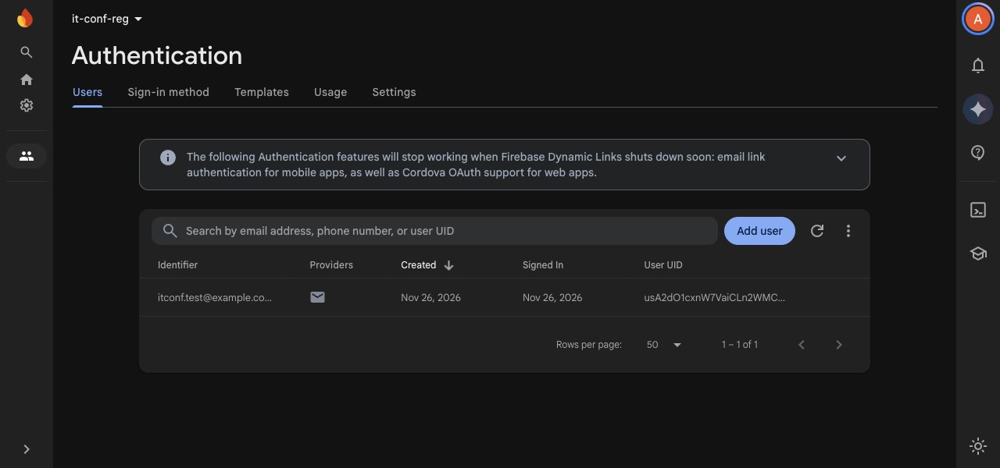

# Основы Dart и Flutter — курс Stepik

Решения курса **«iOS, Android или кроссплатформенность? Основы Dart»**
(https://stepik.org/course/127625) и Flutter-приложение с формой регистрации и авторизацией через Firebase.

**Студент:** Накысбек Асем
**Дисциплина:** Разработка приложений для мобильных устройств на Flutter/Dart (7 семестр, 2026–2027)
**Результат курса:** 602 / 602 баллов, пройдено 65 / 65 шагов.

## Структура

| Папка | Тема | Что внутри |
|-------|------|-----------|
| `01_basics/` | Переменные, ветвление, циклы | 10 задач: ввод/вывод, `if`, `for`, `while` |
| `02_functions/` | Функции | 9 задач: функции, параметры по умолчанию, именованные параметры, функции высшего порядка |
| `03_oop/` | ООП | классы `Animal`, наследники `Bird`/`Fish`/`Insect`, переопределение методов, иерархия школы (миксины), стратегия |
| `04_data_structures/` | Структуры данных | 10 задач: `List`, `Map`, `Set`, матрицы, очередь |
| `05_async/` | Асинхронное программирование | пример `Future`, `then`, `catchError`, `whenComplete`, `async/await` |
| `06_registration_app/` | Форма регистрации + Firebase | Flutter-приложение: вход через Firebase Auth и форма на 7 вопросов |
| `screenshots/` | — | скриншоты работы приложения |

## Запуск задач курса

Каждый `.dart` файл — отдельная программа, читает данные из консоли:

```bash
dart run 01_basics/04_max_of_three.dart
```

## Приложение: регистрация на IT-конференцию

Форма регистрации на IT-конференцию с авторизацией через Firebase (проект `it-conf-reg`).
Подробности и запуск — в [`06_registration_app/README.md`](06_registration_app/README.md).

| Вход | Форма | Отправка | Пользователь в Firebase |
|------|-------|----------|-------------------------|
|  |  |  |  |
